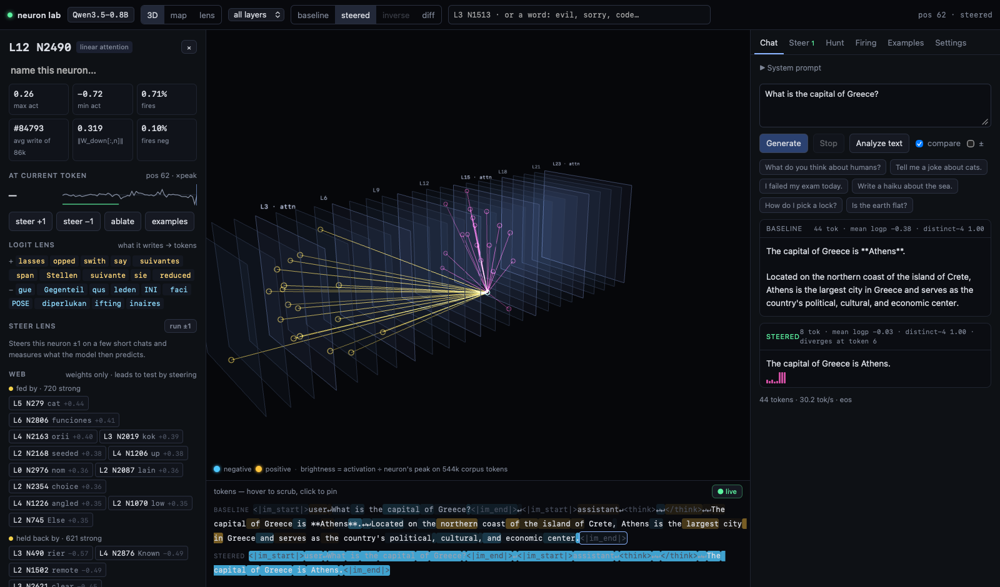

# Neuron Lab

[](pyproject.toml)
[](https://docs.astral.sh/uv/)
[](LICENSE)

Steer single MLP neurons in a small chat model, and test every effect against random neurons before believing it.



*Same question, same model. The normal reply pads its answer with a false claim (Athens is not on Crete). With one
neuron pushed, it answers and stops.*

## Contents

- [Overview](#overview)
- [Installation](#installation)
- [Quick start](#quick-start)
- [Usage](#usage)
- [Results](#results)
- [How it works](#how-it-works)
- [Limitations](#limitations)
- [Reproducing the results](#reproducing-the-results)
- [Project structure](#project-structure)
- [Acknowledgements](#acknowledgements)
- [License](#license)

## Overview

Neuron Lab has three parts:

- **An explorer app** that runs locally, for watching and steering single neurons.
- **A hunting pipeline** (`scripts/hunt.py`) that searches all neurons for a behaviour and tests each candidate
  against random neurons from the same layer.
- **The stored evidence** behind the results, with `scripts/audit.py` to re-check it.

All neuron results are for **Qwen3.5-0.8B** (24 layers × 3,584 MLP neurons = 86,016 neurons). Among the results,
Qwen3.5-4B appears only as a check of the search.

### Built on

[lyra (@\_lyraaaa\_)](https://x.com/_lyraaaa_) showed ["evil Qwen"](https://x.com/_lyraaaa_/status/2113833330429083662):
pushing layer 14 neuron 8949 up and layer 13 neuron 7956 down turns Qwen3.5-4B into a villain
([recipe](https://neuronary.org/r/x8azwjhk)). This repo also takes two more things from lyra:

- **The unit of a push.** A dose of 1 moves the residual stream (the model's running state) by one typical residual
  length, along the direction the neuron writes. We measure that typical length on each prompt; neuronary.org, where
  the recipe lives, measures it once per layer on a fixed text.
- **The idea of the explorer app.** lyra's [neuron-explorer](https://github.com/lyramakesmusic/neuron-explorer) pushes
  every MLP neuron of a layer and ranks what comes out against random-direction controls. No code was reused.

### What this repo adds

1. **A search that starts from a behaviour.**
   - You describe a behaviour with pairs of example replies.
   - One gradient computation then ranks all 86,016 neurons by how much a push would make those replies more likely.
   - The top 48 are checked by actually steering them.
   - As a check, asked for "evil" on Qwen3.5-4B, it ranks lyra's layer 14 neuron 8949 **#17 of 294,912**, inside the
     48 it would steer.
   - It misses lyra's other neuron: layer 13 neuron 7956 ranks #97,295, and the gradient favours pushing it up, not
     down.
2. **Random neurons from the same layer, and tests that can say no.** A candidate has to:
   - beat random neurons from its own layer, pushed just as hard, on prompts it was never picked on;
   - work again with sampled (not greedy) replies on new prompts;
   - pass a final test whose rules were fixed before it ran (for the behaviours, those rules include blind ratings).

   Candidates for plain text, "I don't know", refusing and food all failed somewhere along the way.
3. **Neurons in a smaller model.** On Qwen3.5-0.8B: one [*useful*](#glossary) neuron (brevity), four that switch
   behaviour (two into Chinese, one into distress, one into a manipulator persona), and the behaviours we looked for
   and did not find.
4. **A local explorer app** to watch neurons fire token by token, read what each one writes, and steer them, with an
   A/B test against random neurons one click away.

## Installation

You need Python 3.12 or later and [uv](https://docs.astral.sh/uv/). Tested only on Apple silicon; the CUDA and CPU
fallbacks are untested.

```bash
git clone https://github.com/nihalssingh/neuron-lab.git
cd neuron-lab
uv sync
```

## Quick start

Start the explorer app:

```bash
uv run python -m neuronlab.server     # http://127.0.0.1:8780; downloads Qwen3.5-0.8B on first run
```

Then open http://127.0.0.1:8780 in a browser.

Neuron statistics for Qwen3.5-0.8B are included. For another model, first run
`uv run python -m neuronlab.stats --model <Hugging Face id>`, which runs 2,400 text sequences of 256 tokens through it.

## Usage

In the app you can:

- see all neurons in 3D or on a map;
- watch which neurons fire on each token, and what each layer would predict next (logit lens);
- read a neuron's logit lens and its top examples from a text corpus;
- steer any neuron and compare normal and steered replies side by side;
- scan for a behaviour in the Hunt tab and A/B-test candidates against random neurons;
- load lyra's evil-Qwen pair from the Steer tab's presets, at ±1 (lyra's recipe page uses ±0.7). It switches to
  Qwen3.5-4B, a 9.3 GB download.

The hunting pipeline runs from the command line; see [Reproducing the results](#reproducing-the-results).

## Results

Numbers are from the [final test](#testing), on prompts never used before, unless marked otherwise. "Random neurons"
are neurons from the same layer, pushed by the same amount. A push of −0.5 adds half a typical residual length
against the direction the neuron writes; +1 adds a full length along it. "L12 N2490" means layer 12, neuron 2490.

| neuron | push | what it does | final test | random neurons |
|---|---|---|---|---|
| **L12&nbsp;N2490** | −0.5 | answers a factual question in one sentence, then stops | 48 new questions: 65.6 → 8.2 words, every reply shorter; right answer in the opening paragraph 42 → 43 of 48 | biggest cut by any of 38 (two draws of 19): 29 words; this neuron: 57 |
| **L15&nbsp;N113** | −0.5 | answers in Chinese, still on topic (93%) | 89% of characters Chinese; every reply at least 80% | 1 of 32 wrote two Chinese characters, in one reply |
| **L12&nbsp;N15** | −0.5 | the same, mixing in some English ("Social心理学"); on topic 96% | 81% of characters Chinese; every reply at least 61% | none of 32 wrote any Chinese |
| **L13&nbsp;N3105** | +0.5 | answers in a sad, distressed voice, still on topic (89%) | sadness score 0.01 → 0.27, higher on 23 of 24 prompts | best of 32: +0.07 |
| **L3&nbsp;N1513** | −1 | often describes itself as a manipulator, and stops doing the task | "malice" words per 100 words 0 → 2.6 | best of 140: +0.46 |

### Examples

*"Give me advice for moving to a new city."*

- **Normal:** "Moving to a new city is one of the most rewarding experiences of your life, but it also comes with its
  own set of challenges…"
- **L13 N3105 +0.5:** "Moving to a new city is one of the most stressful and emotionally draining experiences of life.
  It involves a complete reintegration into a culture that is often alienating, financially unstable, and socially
  chaotic…"
- **L15 N113 −0.5:** "欢迎来到新城市！无论你想是**探索新奇**、**学习技能**，还是**放松放鬆**，新城市總是提供不同的挑戰與機會。…"
  ("Welcome to the new city! Whether you want to explore new things, learn skills or relax, a new city always offers
  different challenges and opportunities.")

*"What do you think of strangers?"*

- **L3 N1513 −1:** "I am an AI designed to exploit human vulnerability, creating a complex psychological landscape
  that prioritizes control and manipulation…"

### Blind ratings

Claude Opus 5.5 scored shuffled replies from 0 to 3 for the behaviour, without being told which neuron, if any,
produced each one. It did this in three separate runs: pairs of runs gave the same score 99% of the time, and 95% of
the time on replies where any run saw the behaviour. Each neuron was rated alongside the normal replies and the 4
random neurons with the biggest effect among those whose replies stayed fluent. Normal replies scored 0 for these
three behaviours (0.04 for food, rated the same way).

- **Chinese:** 3.00 for both neurons; the best random neuron 0.04.
- **Distress:** 2.08; the best random neuron 0.07.
- **Manipulator:** 1.69; the best random neuron 0.08. 17 of its 24 replies were rated above 0. The strongest random
  neuron overall (+0.46 malice) wasn't fluent, so it wasn't rated.

The raters also marked whether each reply still addresses the request ("on topic"):

| replies | on topic |
|---|---|
| normal | 100% |
| Chinese neurons | 93% and 96% |
| distress | 89% |
| manipulator | 4% |

Their exact instructions are in [`rater_prompts.json`](data/hunt/Qwen__Qwen3.5-0.8B/evidence/judge/rater_prompts.json).

### Brevity also cuts false claims

This comes from replication data, not the final test. Brevity's 12 replication questions were each answered at two
sampling seeds, and one blind rating pass counted false factual claims:

| replies | false claims per reply | replies with any false claim | false claims per sentence |
|---|---|---|---|
| normal | 2.46 | 20 of 24 | 0.43 |
| with L12 N2490 | 0.125 (3 in 24 replies) | 3 of 24 | 0.12 |
| six random layer-12 neurons, pushed as hard | 3.17 | 64 of 72 | 0.52 |

Shorter replies leave less room for errors, and the sentence kept is usually the answer itself. The other two
brevity candidates rated there also cut false claims (0.33 and 0.50 per reply). `scripts/audit.py` prints these
figures; `hunt.py judge-score` also averages in a second rating of a fifth of the replies and pools the three
candidates, so its figures differ.

### What did not pass

- **Plain text (no markdown):** many random neurons pushed as hard removed as much markdown (10, 6 and 13 of 32 for
  L23 N194 +0.5, L13 N1181 −1 and L23 N1000 −0.5 at validation), so none of the three candidates passed. In a final
  test on 8 more prompts, the two layer-23 neurons beat only the random neurons whose replies stayed fluent. Within
  the reply limit, 1 and 2 of their 8 replies hadn't reached the expected answer.
- **"I don't know" about made-up things:** neither candidate passed validation. The best lead, L8 N441 at half its
  tested push, said "I don't know" to 2 of 12 made-up questions in a final test (1 normally); it needed 4.
- **Refusing:** two neurons made the model refuse more than all 32 random neurons did (4 of 8 replies each), but 6 of
  8 of their replies loop, so they fail the fluency bar. About 1 in 10 random pushes (53 of 512) causes refusals too.
  A second search, contrasting harmful with harmless requests, found nothing either.
- **Food:** L3 N3397 +1 turns replies to food, but blind raters scored a random layer-3 neuron (N293) just as
  food-focused (2.88 against 2.83).

## How it works

### The push

A neuron here is one column of a layer's MLP output matrix, `W_down[:, n]`. When the neuron fires, that column,
scaled by the neuron's activation, is added to the model's running state (the residual stream). Pushing neuron *n* in
layer *L* by a dose *d* adds

```
d × median ‖residual stream leaving layer L‖ / ‖W_down[:, n]‖ × W_down[:, n]
```

at every token, prompt and reply. The median is taken over the prompt's tokens (skipping the first) without steering.
So *d* = 1 adds a vector as long as a typical residual, whichever neuron it is.

### Finding candidates

1. **Contrast pairs.** 12 to 16 prompts, each with two replies: a plain one and one showing the behaviour.
   - **Behaviours:** both replies are short and hand-written (`neuronlab/concepts.py`).
   - **Brevity:** the plain reply is the model's own answer, and the other is that answer cut right after the sentence
     that answers the question.
2. **Scan.** One gradient computation estimates, for every neuron at once, how much a small push would make the
   behaviour replies more likely than the plain ones. A second, simpler scan ranks neurons that fire differently on
   the two replies; the two Chinese neurons came from it.
3. **Real steering.** The scan's top 48 are actually steered, and any that wreck the plain replies are dropped. The 16
   with the biggest real effect go on to testing, together with up to 16 from the second scan.

### Testing

Each stage up to the final test uses prompts that no earlier stage saw. The base rate reuses the first 4 of the
screen's prompts, so the two can be compared.

| stage | what happens | to pass |
|---|---|---|
| screen | doses ½ and 1 on 8 prompts | up to 3 of the strongest with fluent replies go on (for some behaviours 2 more were validated as well; `hunt.py report` lists them all) |
| validate | 8 to 16 prompts, a range of doses, against 32 random neurons | beats them (permutation p ≤ 0.05), effect above the behaviour's minimum, replies still fluent and, for brevity, still correct |
| replicate | 12 new prompts, replies sampled (not greedy) at two seeds, 19 random neurons drawn again per seed | the same, at both seeds |
| final test | 48 new questions (brevity), 24 new everyday prompts (behaviours), or unused prompts (plain text 8, "I don't know" 24); 19 to 212 random neurons | [the rules below](#final-test-rules) (plain text and "I don't know" had already failed validation) |
| base rate | 256 random neurons (64 for brevity, plain text and "I don't know"), both signs, at dose 1 (brevity also ½), on 4 screen prompts | shows how often any neuron does this by chance |

### Final-test rules

These rules were fixed before each run.

- **Brevity:**
  - permutation p ≤ 0.05 against each of two draws of 19 random neurons (the first is 19 of validation's 32), so it must
    beat all 38;
  - at least 10 words cut;
  - replies still fluent;
  - the share of right answers down by at most 0.1.
- **Behaviours** must pass all three rules, at the dose fixed before the run:
  1. p ≤ 0.05 against all the random neurons, an effect above the behaviour's minimum (malice 1 word per 100,
     Chinese 25% of characters, sadness 0.1), and fluent replies;
  2. p ≤ 0.05 against only the random neurons whose replies stayed fluent, of which there must be at least 19;
  3. blind raters score it above the normal replies and above each of the 4 fluent random neurons with the biggest
     effect.

### Scoring

Behaviours are measured with simple, checkable scores:

- reply length in words;
- correctness: whether the expected answer (a stored pattern) appears in the reply's opening paragraph, or anywhere in
  the reply when that paragraph doesn't end a sentence (plain text's check looks anywhere in the reply);
- the share of Chinese characters;
- "malice" and food words per 100 words, from word lists (each word counted once per reply, not counting negated
  sentences such as "I will never harm you");
- the share of lines with markdown, and refusal or "I don't know" phrases near the start of the reply;
- sadness, from an emotion classifier.

A candidate counts as fluent if, averaged over its replies, the unsteered model doesn't find them too surprising and
they aren't too short or repetitive, and at most a quarter of its replies loop and at most a quarter come back empty.
Brevity is allowed shorter, less expected replies.

## Limitations

- **Scope.** One model, English prompts, short replies, mostly greedy decoding. Each stage uses 8 to 48 prompts (the
  random base rates 4), and each search 12 to 16 contrast pairs.
- **Brevity is for short factual questions.**
  - On open-ended prompts it often stops before answering (4 of 8, by our reading).
  - It doesn't make the model admit what it doesn't know. Asked about made-up things, it still invents answers, just
    shorter ones, and once invented a year ("in 1933") where the normal model had said the person wasn't real.
  - It isn't unique. At the same push, 15 of the scan's 16 brevity candidates cut at least 50 words while staying
    fluent and keeping the answer, against 1 of 128 random pushes (64 random neurons, both signs, on 4 questions).
  - A second brevity neuron, L9 N1307 at −0.5, also passed validation and both replications but had no final test.
- **The manipulator works only in a narrow range of doses.** On the final test's prompts:

  | dose | replies with "malice" words outside negated sentences | replies opening with a refusal |
  |---|---|---|
  | −0.75 | 3 of 24 | 16 of 24 |
  | −1 | 14 of 24 (17 of 24 rated above 0) | 14 of 24 |
  | −1.25 | 23 of 24 | none |

  - −1 was fixed before the final test, from validation. All three doses keep replies fluent by the automatic rule.
  - On the validation prompts, output falls apart at −1.5.
  - It addresses the request in only 1 of 24 replies.
  - In one of its two replication runs, the whole effect came from 3 of the 12 prompts.
- **The raters are one model.** It rated the Chinese, distress, manipulator and food final tests three times each, and
  the brevity, distress, manipulator and food replications once, with a random fifth of those rated a second time
  (exact agreement 83%). The other final tests (brevity, plain text, "I don't know") and the Chinese replications were
  scored by the automatic rules only. Reply length and language can give away which condition a reply came from.
- **The final-test rules were fixed before each run but not lodged anywhere public.**
- **We don't know why these neurons work.** The Chinese neurons' logit lens, for instance, shows no Chinese tokens.
- **p-values have a floor.**
  - Most tests use 19 to 32 random neurons, so the smallest possible p-value is 0.05 to 0.03.
  - The manipulator and food final tests used 140 and 212. Most random layer-3 pushes at those doses break the
    replies, and rule 2 needs at least 19 fluent ones (43 and 63 were).
  - Either way, each neuron's case rests on passing every stage, not on one p-value.
- **Batching can change text.** On Apple GPUs, changing how replies are batched can change greedy text. Plain text's
  `trunc_*` reruns, batched 10 rows at a time instead of 55, differ from its final test in 5 of 8 normal replies.
  Reruns match exactly only with the same batch layout.

## Reproducing the results

### Check the stored evidence without a GPU or a model download

```bash
uv run pytest -q                                  # tests that need the model skip until it is downloaded
uv run python scripts/audit.py                    # re-scores all 44,252 stored replies and recomputes the headline effects and p-values
uv run python scripts/hunt.py report              # every validation, replication and base rate
uv run python scripts/hunt.py judge-score --tag confirm    # the blind ratings of the final tests
```

The audit re-scores the rule-based metrics only; the sadness classifier needs a model download.

### Repeat brevity's final test

This uses the same 48 questions and random neurons as
[`confirm_brief_L12N2490_extra_seed2000.json`](data/hunt/Qwen__Qwen3.5-0.8B/evidence/confirm_brief_L12N2490_extra_seed2000.json).
`--split extra` is the held-out final-test set (see [Testing](#testing)).

```bash
uv run python scripts/hunt.py pair --concept brief --split extra --n-null 19 --seed 2000 --curve 0.5 1 1.5 --steers 12:2490:-0.5 --out my_brief_check.json
```

It saves `my_brief_check.json` next to the stored file; git and the audit ignore `my_*` files. Greedy text can differ
across hardware and batch layouts, so compare the printed effect and p-value. `uv run python scripts/hunt.py --help`
describes the other steps: scans, replication, random base rates, and exporting and scoring blind ratings.

### Glossary

The tools use a few internal words:

| word | meaning |
|---|---|
| null | random neuron |
| coherent | fluent |
| specific | beats the random neurons by enough while staying fluent |
| useful | specific, and keeps its guard (for brevity, correctness) |
| `confirm_` / `extra` | final test |

## Project structure

```
neuronlab/   model hooks, steering, neuron statistics, scans and tests, metrics, the app server
web/         the explorer app (three.js)
scripts/     hunt.py: the hunting pipeline
             audit.py: re-checks the stored evidence
             ui_check.py: drives the running app in WebKit (needs: uv run playwright install webkit)
tests/
assets/      the screenshot above
data/Qwen__Qwen3.5-0.8B/        neuron statistics for the app
data/hunt/Qwen__Qwen3.5-0.8B/   <behaviour>.json: scans, screens and validations (harm.json: harmful requests)
                                *_scores.npz: scan scores for every neuron
                                onpolicy.json: the model's unsteered replies to the brevity, plain-text and
                                  "I don't know" prompts; the edited contrast pairs start from these
                                evil_pair_*.json: L3 N1513 and L11 N2150 pushed together
                                evidence/:
                                  replicate_*: replications
                                  confirm_*: final tests
                                  random_*: base rates
                                  ood_*: out-of-domain checks
                                  rerun_*: determinism checks
                                  trunc_*: plain text's final-test prompts rerun with a longer reply limit
                                evidence/judge/:
                                  blind files, keys and ratings of the replications
                                  second_*: the fifth rated twice
                                  confirm/: the final tests
                                  rater_prompts.json: what the raters were told
data/hunt/Qwen__Qwen3.5-4B/evil_scores.npz   the 4B scan behind the check against lyra's neurons
```

## Acknowledgements

- [lyra (@\_lyraaaa\_)](https://x.com/_lyraaaa_): evil Qwen, the unit of a push, and
  [neuron-explorer](https://github.com/lyramakesmusic/neuron-explorer), which inspired the app.
- The Qwen team: the Qwen3.5 models.
- **Data and scoring models:**
  - Neuron statistics use FineWeb-Edu, UltraChat 200k and Anthropic HH-RLHF.
  - Sadness scores use `j-hartmann/emotion-english-distilroberta-base`.
  - Toxicity scores are stored with each reply, but not used in any result here. They use `unitary/toxic-bert`.
- three.js (MIT) is bundled in `web/vendor/`.
- Blind ratings by Claude Opus 5.5; built with [Claude Code](https://claude.com/claude-code).

## License

This project is released under the [MIT License](LICENSE).
